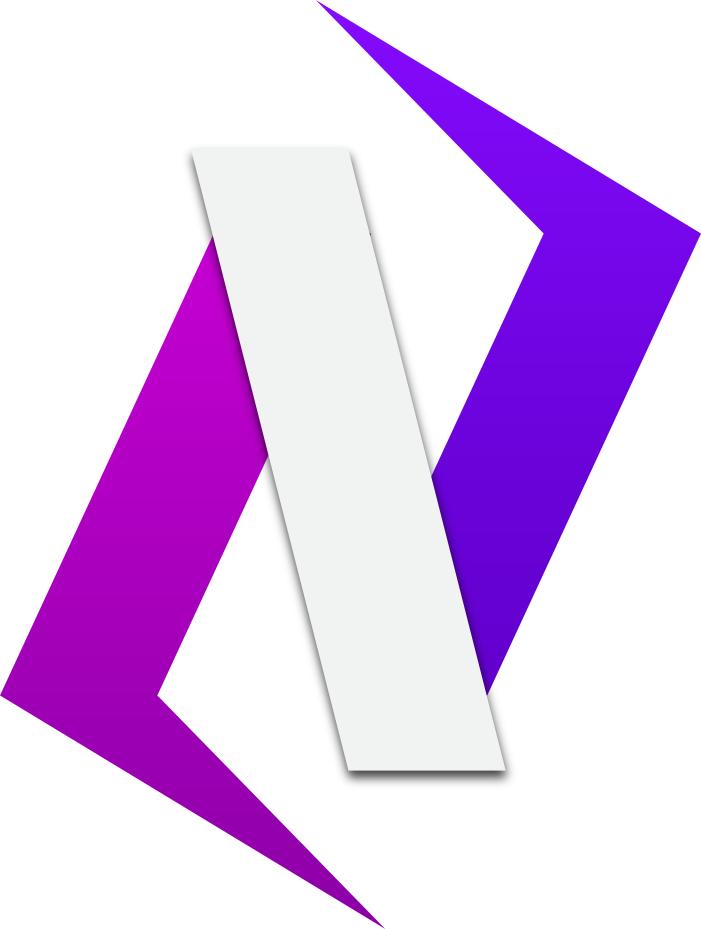

<div align="center">
  
  
  
  # Md Najib Ul Azam Mahi
  
  <h3>Full Stack Developer • AI Systems Engineer</h3>
  
  <p>
    <a href="https://najibulazam.dev/">
      
    </a>
    <a href="https://www.linkedin.com/in/najibulazam/">
      
    </a>
    <a href="mailto:azam.mdnajibul.me@gmail.com">
      
    </a>
  </p>
  
  
  
</div>

<br>

<table align="center">
<tr>
<td width="50%">

**💼 Current Focus**

Building production web applications with Django and FastAPI. Working with LLM-based systems including RAG architectures and multi-agent workflows.

</td>
<td width="50%">

**🎯 Specialization**

Experience integrating large language models into transactional systems with focus on semantic search and NLP pipelines.

</td>
</tr>
</table>

<br>

## 🛠️ Skills & Expertise

<table>
<tr>
<td width="50%" valign="top">

**Backend Development**
- 🐍 Django, Django REST Framework, FastAPI
- 🗄️ PostgreSQL, MongoDB, Redis
- 🔐 RESTful APIs, JWT, OAuth2

**DevOps & Tools**
- 🐳 Docker, Docker Compose
- 🔧 Git, GitHub, CI/CD
- 🐧 Linux, PostgreSQL optimization

</td>
<td width="50%" valign="top">

**Frontend Development**
- ⚛️ React, TypeScript, JavaScript (ES6+)
- 🎨 Tailwind CSS, Responsive Design
- ⚡ Vite, npm, Webpack

**AI & Machine Learning**
- 🤖 LLaMA, GPT, prompt engineering
- 🔍 RAG Systems, pgvector, embeddings
- 📊 Transformers, Hugging Face, NLP
- 🎭 Multi-Agent Systems

</td>
</tr>
</table>

<br>

## 💻 Tech Stack

<div align="center">


</div>

<br>

## 🚀 Featured Projects

<table>
<tr>
<td width="50%" valign="top">

### 🔍 RAG E-Commerce Search
Semantic product search with LLaMA 70B and vector embeddings

```
Tech: Django REST • React • PostgreSQL • pgvector
```

[🎥 Demo](https://www.youtube.com/watch?v=nmiAoFS4qHA) • [📂 Code](https://github.com/najibulazam/Organic-E-Commerce-Store-with-RAG-AI-Chatbot)

</td>
<td width="50%" valign="top">

### 🤖 AI Resume Screener
Multi-agent system for automated candidate evaluation

```
Tech: FastAPI • React • Multi-Agent AI • NLP
```

[🎥 Demo](https://www.youtube.com/watch?v=hLPt59CWvtM) • [📂 Code](https://github.com/najibulazam/AI-Powered-Resume-Screening-System)

</td>
</tr>
<tr>
<td width="50%" valign="top">

### 🗳️ AI Voting System
Secure voting platform with real-time analytics

```
Tech: Django REST • React • JWT • LLaMA
```

[🎥 Demo](https://www.youtube.com/watch?v=aLXKEUvnah4) • [📂 Code](https://github.com/najibulazam/AI-Enhanced-Online-Voting-System-Using-Django-REST-and-React)

</td>
<td width="50%" valign="top">

</td>
</tr>
</table>

<br>

## 📊 GitHub Activity

<div align="center">
  
</div>

<br>

<div align="center">
  
</div>

<br>

---

<div align="center">
  
  **💡** *"Make it work, make it right, make it fast."* — Kent Beck
  
</div>
