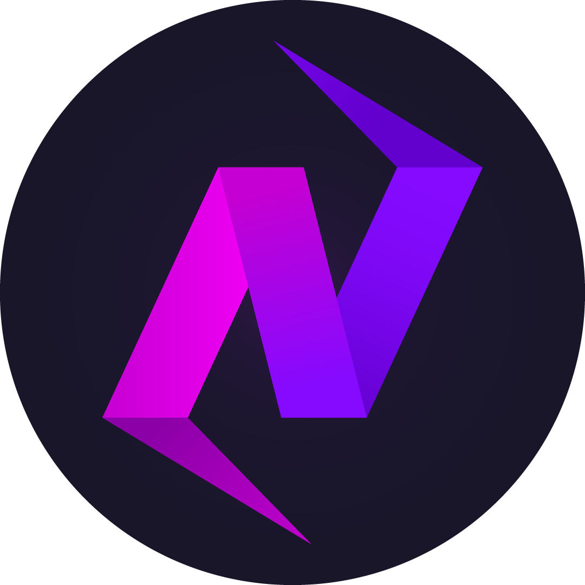

<div align="center">
  
</div>

<div align="right">
  
</div>

<div align="center">
  
</div>

<br/>

## 🚀 Quick Intro

```python
dev = {
    "name": "Md Najib Ul Azam Mahi",
    "role": "Full Stack Developer & AI Engineer",
    "location": "Dinajpur, Bangladesh",
    "focus": ["Django", "FastAPI", "React", "AI/ML", "RAG Systems"],
    "currently": "Building AI-powered web solutions 🤖"
}
```

<div align="center">

### [ Check Out My Portfolio →](https://dev-najib.netlify.app/)

</div>

<br/>

## 🛠️ Tech Stack

<div align="center">

**Backend:**    

**Frontend:**     

**AI/ML:**    

**Database:**   

**Tools:**    

</div>

<br/>

## 📊 GitHub Stats

<div align="center">
  
</div>

<div align="center">
  
</div>

<div align="center">
  
  
</div>

<div align="center">
  
  
</div>

<br/>

## 🎯 Featured Projects

<table>
<tr>
<td width="50%">

### 🛒 E-Commerce with AI Chatbot
RAG-powered shopping assistant with semantic search

**Stack:** Django REST, React, PostgreSQL, LLaMA 70B

[](https://www.youtube.com/watch?v=nmiAoFS4qHA) [](https://github.com/najibulazam/Organic-E-Commerce-Store-with-RAG-AI-Chatbot)

</td>
<td width="50%">

### 🤖 AI Resume Screener
Multi-agent system for automated hiring

**Stack:** FastAPI, React, Multi-Agent AI, NLP

[](https://www.youtube.com/watch?v=hLPt59CWvtM) [](https://github.com/najibulazam/AI-Powered-Resume-Screening-System)

</td>
</tr>
<tr>
<td width="50%">

### 🗳️ AI Voting System
Secure voting with AI analytics & predictions

**Stack:** Django REST, React, JWT, LLaMA

[](https://www.youtube.com/watch?v=aLXKEUvnah4) [](https://github.com/najibulazam/AI-Enhanced-Online-Voting-System-Using-Django-REST-and-React)

</td>
<td width="50%">

### 💼 Developer Portfolio
Modern portfolio with animated backgrounds

**Stack:** React 19, Vite, Tailwind CSS 4

[](https://md-najib-ul-azam.netlify.app/) [](https://github.com/najibulazam/Najib-Portfolio)

</td>
</tr>
</table>

<br/>

## 🌐 Let's Connect

<div align="center">
  
[](https://www.linkedin.com/in/najibulazam/)
[](https://www.facebook.com/itsnajibul)
[](mailto:azam.mdnajibul.me@gmail.com)
[](https://t.me/itsnajibul)
[](https://wa.me/8801978264938)

</div>

<br/>

<div align="center">
  


</div>

<br/>

<div align="center">
  
</div>

<div align="center">
  
### 💡 *"Talk is cheap. Show me the code."* – Linus Torvalds

**⚡ Fun Fact:** My code works, I have no idea why. My code breaks, I have no idea why. Welcome to programming! 🤷‍♂️

</div>

<div align="center">
  
</div>
